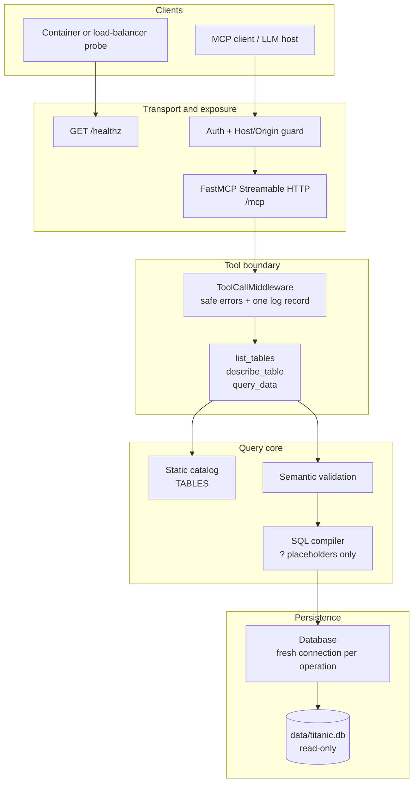

# Architecture and Design Rationale

> **Scope.** This document explains the code in the repository as of **2026-10-28**,
> including Streamable HTTP at `/mcp`, configuration and profiles, bearer
> authentication, host/origin protection, `GET /healthz`, and the container
> deployment. Decision history lives in OpenSpec:
> `openspec/changes/archive/2026-10-27-add-titanic-query-core/design.md`,
> `openspec/changes/archive/2026-10-27-add-mcp-query-tools/design.md`,
> `openspec/changes/archive/2026-10-27-add-mcp-http-service/design.md`, and
> `openspec/changes/archive/2026-10-28-add-container-deployment/design.md`.

## Contents

1. [What the service is](#1-what-the-service-is)
2. [The 30-second version](#2-the-30-second-version)
3. [Layering](#3-layering)
4. [End-to-end flows](#4-end-to-end-flows)
5. [Why the code is written this way](#5-why-the-code-is-written-this-way)
6. [Error contract](#6-error-contract)
7. [Logging contract](#7-logging-contract)
8. [HTTP configuration reference](#8-http-configuration-reference)
9. [Security model](#9-security-model)
10. [Test strategy](#10-test-strategy)
11. [Current implementation status](#11-current-implementation-status)
12. [How to change the system safely](#12-how-to-change-the-system-safely)
13. [Glossary](#13-glossary)

## 1. What the service is

Titanic MCP is a **read-only MCP server** over a SQLite copy of the Titanic passenger
manifest. An MCP client (an LLM host, an IDE, or a test harness) can:

1. discover the available tables,
2. inspect one table's columns and types,
3. run a bounded, typed query with projection, filters, ordering, and pagination.

The server does **not** accept SQL. It accepts a small JSON query language and
compiles that language into parameterized SQL against a fixed catalog.

There are two distinct products in one process:

| Product | Consumer | Contract |
|---|---|---|
| MCP tool surface | MCP clients | Three tools, strict JSON schemas, safe errors |
| Query core | Tool layer and tests | Catalog semantics, validation, SQL compilation |

The separation is the central architectural decision. Everything else follows from
it.

## 2. The 30-second version

- **Three tools only:** `list_tables`, `describe_table`, `query_data`.
- **Nine catalog entries:** one curated `passengers` view plus eight raw tables.
- **No user SQL:** table and column names are dictionary lookups; values are bound
  parameters.
- **Read-only by construction:** SQLite is opened with `mode=ro`, `PRAGMA query_only`,
  and a fresh connection per operation.
- **One error chokepoint:** the tool middleware maps every failure to either
  `Invalid arguments: <paths>` or `Internal error.` and logs the detail.
- **One log record per call:** a canonical `event="tool_call"` record on stderr with
  metadata only, never values, SQL, arguments, or tokens.
- **Fail-closed HTTP profiles:** `local`, `container`, and `remote` validate their
  security settings before the app accepts a request.

## 3. Layering



### Module map

| Module | Owns | Must not own |
|---|---|---|
| `src/titanic_mcp/server.py` | FastMCP app factory, configuration, HTTP entrypoint, three tool wrappers, middleware, safe-error adapter | Catalog semantics, SQL construction, database access |
| `src/titanic_mcp/queries.py` | Static catalog, semantic validation, SQL compilation, pagination envelope | MCP, HTTP, SQLite connections |
| `src/titanic_mcp/database.py` | Read-only SQLite connections and execution | Catalog knowledge, MCP types |
| `src/titanic_mcp/models.py` | Pydantic input/output models, enums, structural validation | Database or framework behavior |
| `src/titanic_mcp/errors.py` | Error taxonomy shared by core and server | FastMCP-specific error mapping |
| `src/titanic_mcp/logging_config.py` | JSON formatter, log setup, narrow FastMCP warning filter | Tool behavior |
| `src/titanic_mcp/__init__.py` | Re-export `main` for the `titanic-mcp` script | Business logic |

### Dependency direction

```text
__init__.py ──> server.py ──> queries.py ──> models.py
                    │              └──────> errors.py
                    ├──> database.py
                    ├──> logging_config.py
                    └──> models.py, errors.py
```

The core modules do not import `server.py` or FastMCP. `logging_config.py` imports
`fastmcp` only inside `configure_logging()`, keeping the module import side-effect
free and the formatter independently testable. This direction is what lets domain
and security tests run without a server, and it is why moving the transport from
stdio to HTTP did not require touching query semantics.

## 4. End-to-end flows

### 4.1 Startup

```text
environment
   │
   ▼
load_config(environ) ──> parse profile, host, port, database path, token,
   │                      allowlists, log level, log format
   ▼
validate_config(config) ──> reject contradictory security combinations
   │
   ▼
Database(...).fetch_one("SELECT 1") ──> configuration error if unreadable
   │
   ▼
configure_logging(...)  ──> stderr handler, JSON or text
   │
   ▼
create_app(database, config)
   ├── FastMCP(name, instructions, strict_input_validation, mask_error_details)
   ├── auth provider (only when a token is configured)
   ├── ToolCallMiddleware
   ├── GET /healthz
   └── three tools bound to one Database instance
   │
   ├── main() ──> .run(transport="http", ..., show_banner=False)
   └── http_app() ──> .http_app(path="/mcp", ...) for tests/embedders
```

`create_app()` deliberately does **not** open the database. `Database` only stores the
path and URI; a connection is opened per operation. This makes app construction
cheap and avoids a long-lived shared connection. `main()` opens the configured
database once before serving and exits if it is missing or unreadable, so a running
server has already proved the file is accessible. `show_banner=False` keeps startup
from contacting PyPI.

`main()` calls `load_config()`, catches `ConfigurationError`, and turns it into a
clean `SystemExit("Configuration error: ...")`. A misconfigured deployment therefore
fails before binding a port, with no traceback and no partially running server.

### 4.2 A `query_data` call

1. **FastMCP decodes the JSON-RPC request** and validates the tool signature:
   strict strings/integers, `extra="forbid"`, `limit` 1–500, `offset` ≥ 0.
2. **`_safe_tool` wraps the handler.** Domain errors are converted into a
   middleware-visible `ToolError` subclass (see §6).
3. **The handler builds `QueryDataInput`.** This second validation catches
   cross-field rules the JSON schema cannot express, such as duplicate column names.
4. **`queries.validate_query()` checks semantics:** the table exists in the catalog,
   every projected/filter/order column exists, the operator is allowed for that
   column's type, values match the column type, at most 20 predicates, `in` has
   1–100 values, and null operators carry no value.
5. **`queries.compile_query()` builds static SQL** from the catalog's `source_sql`,
   the validated projection, bound filter values, deterministic ordering, and
   `LIMIT ? OFFSET ?`.
6. **`Database.fetch_all()` opens a fresh read-only connection**, executes the
   statement with bound parameters, and returns ordered mappings.
7. **`build_response()` slices the `limit + 1` fetch** into the public envelope:
   `rows`, `row_count`, `truncated`, and `next_offset`.
8. **`ToolCallMiddleware` emits one canonical log record** in `finally`, regardless
   of success or failure, and maps any exception to the safe client contract.

The compiled SQL has this shape:

```sql
SELECT "sex", "age"
FROM (
  SELECT
    o.rowid AS passenger_id,
    ...
    CASE WHEN o.embarked_id = -1 THEN NULL ELSE e.embarked END AS embarked,
    ...
  FROM "Observation" AS o
  LEFT JOIN "Sex" AS s ON s.sex_id = o.sex_id
  ...
) AS source
WHERE "age" >= ? AND "sex" = ?
ORDER BY ("age" IS NULL) ASC, "age" DESC, "passenger_id" ASC
LIMIT ? OFFSET ?
```

Parameters are `(30, "female", limit + 1, offset)`. The only interpolated tokens are
quoted identifiers from the catalog and `ASC`/`DESC` from a closed enum.

### 4.3 `list_tables` and `describe_table`

Both delegate to `queries.py`. The only database work is a live
`SELECT COUNT(*) FROM (<source_sql>)` per catalog entry. With 891 rows this is cheap,
and it avoids a metadata cache with invalidation rules. `describe_table` returns the
catalog's ordered `ColumnSpec` list; it does not introspect SQLite at request time.

## 5. Why the code is written this way

### 5.1 A curated catalog, not schema introspection

**Decision.** `TABLES` is a hand-written registry of nine `TableSpec` objects. Each
spec owns a static `source_sql`, ordered `ColumnSpec`s, a description, a default
order, and a tiebreaker. `passengers` is a logical view built with joins, not a
database view.

**Why.**

- The raw schema is normalized and hostile to a language model: lookup IDs, `-1`
  sentinels, and no primary keys. A curated layer can expose `sex`, `class`, `deck`,
  and `embark_town` as readable labels, and map `-1` to `NULL`.
- The catalog is the **public contract**. If the database gains a column, the tool
  surface does not change silently; a code change and a test update are required.
- Introspection would expose `sqlite_master` and internal columns, and would make
  schema drift a runtime surprise instead of a test failure.
- The catalog gives the compiler a finite set of known identifiers, which is the
  basis of the no-user-SQL guarantee.

**Cost.** Adding a column or table requires code changes. Drift is caught by
`tests/domain/test_catalog_matches_schema.py`, which compares catalog columns with
`PRAGMA table_info` and every `source_sql` with its declared columns, and by
`test_passengers.py`, which pins decoded values and sentinel behavior.

### 5.2 User input never becomes SQL

**Decision.** Table names select a dictionary entry. Column names are validated
against `TableSpec.column_map` and then quoted by `_quote_identifier()`. Filter
values are always `?` parameters. `in` expands one placeholder per value. `ASC` and
`DESC` come from the `OrderDirection` enum.

**Why.** This is positive security: the compiler can only emit identifiers that were
declared in code. Prompt injection or a malicious MCP client can choose *which*
catalog column to filter, but cannot inject a table, expression, comment, or
statement. Quoting is defense in depth, not the primary control.

An ORM was rejected for this dataset: the schema is tiny and fixed, the SQL is easier
to review and test directly, and an ORM would still need an allowlist for dynamic
identifiers. Arbitrary SQL, joins, aggregates, `GROUP BY`, OR filters, and
multi-column ordering are explicit non-goals; keeping them out is what keeps the
compiler small enough to reason about.

**Guardrail.** `tests/security/test_query_injection.py` feeds malicious table,
column, operator, direction, and limit values; asserts malicious values are absent
from compiled SQL; and verifies the database hash is unchanged.

### 5.3 Read-only by construction

**Decision.** `Database` opens `file:<path>?mode=ro` with `uri=True`, sets
`PRAGMA query_only=ON`, and exposes only `fetch_all`, `fetch_one`, and `count`. There
is no write API. A fresh connection is opened for each operation and closed in a
`finally` block.

**Why.**

- The URI mode prevents accidental writes at the SQLite layer; `query_only` is a
  second, independent guard.
- A missing database file raises instead of being silently created, so a bad mount
  fails loudly rather than serving an empty database.
- Per-operation connections avoid shared mutable state across threads and match the
  synchronous tool execution model. At this dataset size, connection overhead is
  irrelevant.
- Tests hash the database file before and after operations, so a regression that
  writes would be caught even if it did not change visible rows.

**Cost.** No cross-request transaction or prepared-statement cache. Both are
unnecessary for a read-only 891-row dataset.

### 5.4 Validation split: shape at the edge, semantics in the core

**Decision.** Pydantic handles **structural** constraints: required fields, JSON
types, ranges, enums, `extra="forbid"`, non-empty unique column lists. `queries.py`
handles **semantic** constraints: catalog membership, operator/type compatibility,
value/type compatibility, predicate count, and `in` size.

**Why.**

- Pydantic gives MCP clients a machine-readable schema and rejects malformed input
  before any domain code runs.
- The core stays transport-independent. Domain tests can construct
  `QueryDataInput` directly and call `validate_query`/`compile_query` without a
  server, and the same rules apply whether the caller is stdio, HTTP, or a future
  transport.
- Strict types are intentional. Coercing `"10"` into `10` or `1` into `True` hides
  client mistakes and makes filter semantics ambiguous. Clients must send exact JSON
  types; the README documents this.

The `limit` bounds appear in both the tool signature and `QueryDataInput`. The tool
signature exists so clients see `minimum`/`maximum` in the advertised JSON schema;
the model revalidates for direct core callers. They must be kept in sync.

### 5.5 Deterministic pagination with `limit + 1`

**Decision.** Fetch `limit + 1` rows, return at most `limit`, and set
`truncated`/`next_offset` from the presence of the extra row. Ordering always adds a
tiebreaker, and nulls sort last in both directions.

**Why.**

- No separate `COUNT(*)` query is needed to know whether another page exists.
- The tiebreaker (`passenger_id` or the lookup ID) makes offset paging stable:
  rows with equal order values cannot swap between pages, so pages do not overlap or
  skip rows.
- `(expr IS NULL) ASC` puts non-null values before nulls for both `ASC` and `DESC`,
  which is the documented behavior rather than SQLite's default null ordering.
- Because the database is read-only, offset paging is stable for the life of the
  process.

**Cost.** `row_count` is the size of the returned page, not the total number of
matching rows. That is intentional and documented in the response envelope. Callers
who need a total must page until `truncated` is false.

### 5.6 Thin tools, fat core

**Decision.** Tool handlers only adapt: build a core input, call a core function, and
serialize the result with `model_dump(mode="json")`. They do not build SQL or open a
database.

**Why.** Query semantics have exactly one home. Transport changes (stdio to HTTP),
framework changes, and schema changes do not get duplicated into tool handlers. The
integration tests can assert that the tool result is the core envelope unchanged,
which is a useful contract test.

**Cost.** A little boilerplate per tool. In exchange, a bug in filtering or ordering
is fixed in one place and covered by domain tests that do not need a server.

### 5.7 The safe-error pipeline exists because FastMCP masks errors

**Decision.** `_safe_tool` catches `QueryValidationError` and `SafeToolError` and
re-raises them as `_ClassifiedToolError`, a `ToolError` subclass carrying `status`,
`error_type`, and `field_paths`. `ToolCallMiddleware` maps that classification to the
client message and log record.

**Why this indirection is necessary.** FastMCP is configured with
`mask_error_details=True`. It replaces non-`ToolError` exceptions with a generic
error **before middleware sees them**. If the tool simply let
`QueryValidationError` escape, the middleware would see a generic framework error,
not the domain error, and a safe `Invalid arguments: table` would degrade into
`Internal error.`. Re-raising as a `ToolError` preserves the classification.

`_ClassifiedToolError` lives in `server.py` rather than `errors.py` because the core
must not depend on FastMCP. The server owns framework coupling; the core owns
meaning.

Decorator order also matters:

```python
@mcp.tool
@_safe_tool
def query_data(...): ...
```

`_safe_tool` is applied first, so FastMCP registers and calls the wrapper. Reversing
the order would register the raw function and lose the classification.

**Sharp edge.** `_safe_tool` is a synchronous wrapper. If a tool becomes `async`, the
wrapper must become async or it will return a coroutine without awaiting it.

### 5.8 One canonical log record, metadata only

**Decision.** Use stdlib `logging`, a JSON formatter on **stderr**, and emit exactly
one `event="tool_call"` record per call in `finally`. Disable FastMCP's own log
handlers and filter only its duplicate raw validation warning.

**Why.**

- Stdout was the MCP stdio protocol. Even though the entrypoint now serves HTTP,
  keeping protocol output and diagnostics separate is a useful invariant and keeps
  the logging contract compatible with a future stdio mode.
- A single record in `finally` guarantees that successes, validation failures,
  safe errors, and unexpected exceptions all produce exactly one audit event with a
  duration and status. Logging at the call sites would produce gaps and duplicates.
- The canonical record contains only metadata: tool name, request/correlation IDs,
  duration, status, error type, table name, filter **count**, and field paths. It
  never contains filter values, raw arguments, SQL, parameters, request bodies, or
  auth tokens. Internal diagnostics are separate records and include exception type
  and traceback.
- FastMCP's own validation warning would duplicate the canonical record, so a narrow
  filter drops only messages starting with `Invalid arguments for tool`; other
  framework diagnostics remain visible.

**Why JSON by default.** The service is meant to run in a container and be scraped or
grepped by machines. Text logs remain available for local debugging via
`TITANIC_MCP_LOG_FORMAT=text`.

### 5.9 Configuration is immutable, parsed at the edge, and revalidated at the app seam

**Decision.** `ServerConfig` is a frozen, slotted dataclass. `load_config(environ)`
parses strings into typed fields; `validate_config()` enforces profile invariants.
`create_app()` and `http_app()` validate again, so direct callers cannot bypass the
checks.

**Why.**

- A frozen object makes the resolved configuration safe to pass around and prevents
  a tool or middleware from mutating security settings at runtime.
- Injecting `environ` makes configuration tests deterministic. `default_config()`
  calls `load_config({})` rather than reading `os.environ`, so app factories used by
  tests do not accidentally pick up a developer's shell settings.
- Failing closed is the right default for a service that can be exposed to a
  network. A missing token or host allowlist should stop startup, not produce a
  partially protected server.
- Revalidating at the app seam is cheap and protects the public
  `create_app`/`http_app` entry points used by tests and embedders.

`auth_token` uses `field(repr=False)` so an accidental `repr(config)` or debug log
does not print the secret. `load_config()` does not log the environment or the token.

### 5.10 Profiles encode trust boundaries

The three profiles are not cosmetic names; they encode where the process is allowed
to be reached and what must be true before it starts.

| Profile | Bind default | Auth | Allowed hosts | Stateless HTTP | Host/origin |
|---|---|---|---|---|---|
| `local` | `127.0.0.1` | none by default; a token is honored if set | optional (empty by default) | `True` | `"auto"` |
| `container` | `0.0.0.0` | none by default; a token is honored if set | **required** | `False` (sessions available) | `True` |
| `remote` | `0.0.0.0` | **required** | **required** | `False` (sessions available) | `True` |

Startup rejects:

- `local` with a non-loopback bind;
- `container` without `MCP_ALLOWED_HOSTS`;
- `remote` without `MCP_AUTH_TOKEN` or `MCP_ALLOWED_HOSTS`;
- an unknown profile, invalid port, unknown log level, or invalid log format.

The `container` profile permits token omission **only because** the intended
deployment publishes the port to loopback. The container change pins
`127.0.0.1:8000:8000`. If an operator publishes `0.0.0.0:8000:8000`, they must switch
to `remote`; the application cannot tell the difference from inside the container.
This is the most important operational trade-off in the current design.

`local` is stateless to avoid session affinity for the common development case.
`container` and `remote` leave FastMCP's session support enabled for clients that use
server-initiated session features. That split is deliberate: a stateless container
deployment would be a configuration change with its own tests, not a silent default.

### 5.11 Health is a shallow, unauthenticated probe

**Decision.** `GET /healthz` is a FastMCP custom route that returns
`{"status": "ok"}` with HTTP 200. Custom routes are outside MCP authentication, so a
probe does not need a bearer token.

**Why.** Container orchestration and load balancers need a cheap liveness signal that
does not initialize an MCP session. Making it depend on the database or a session
would make the probe slow, stateful, and likely to flap.

**Cost and caveat.** `/healthz` means "the HTTP app is accepting requests." `main()`
checks that the configured database is readable before serving, so a server that
started has already passed that check; the probe does not re-check the database. The
host/origin guard still wraps the whole app, so a probe must send an allowed `Host`
header (the intended container allowlist includes `127.0.0.1:8000` and
`localhost:8000`). If ongoing database readiness matters, add a separate check with a
deliberate timeout and document its semantics.

### 5.12 Host/origin protection is not CORS

`host_origin_protection` guards against DNS-rebinding and untrusted browser origins by
validating `Host` and `Origin` before MCP handling. It does **not** add CORS response
headers, and it does not make a browser client work by itself. A browser client that
needs cross-origin access still needs explicit CORS configuration at the deployment
layer. Keeping these concerns separate avoids implying that origin validation is a
complete browser security policy.

## 6. Error contract

Every tool failure passes through `ToolCallMiddleware`:

| Failure | Client receives | Log `status` | Log `error_type` |
|---|---|---|---|
| FastMCP / Pydantic validation | `Invalid arguments: <sorted paths>` | `invalid_arguments` | `validation_error` |
| Core semantic validation | `Invalid arguments: <sorted paths>` | `invalid_arguments` | `domain_validation` |
| Explicit `SafeToolError` | The safe message | `safe_error` | `safe_tool_error` |
| Anything unexpected | `Internal error.` | `internal_error` | `unexpected_exception` |
| Success | Tool result | `ok` | `none` |

Field paths use dotted names and bracket indices (`filter[0].op`, `columns[1]`),
are sorted and de-duplicated, and fall back to `request` when no path is available.
Internal Pydantic error types, locations, and tracebacks are logged separately; they
are never returned to the client.

`InvalidArgumentsError` exists for the second `QueryDataInput` construction in the
`query_data` handler. FastMCP validates the tool signature, but the core model also
rejects things like duplicate column names; raising the domain error keeps that path
inside the same safe classification.

## 7. Logging contract

Canonical record:

```json
{
  "timestamp": "2026-10-27T19:01:48.564346Z",
  "level": "INFO",
  "logger": "titanic_mcp.server",
  "message": "tool_call",
  "event": "tool_call",
  "tool_name": "query_data",
  "request_id": "3",
  "correlation_id": "corr-123",
  "duration_ms": 6.933,
  "status": "ok",
  "error_type": "none",
  "table": "passengers",
  "filter_count": 1,
  "field_paths": []
}
```

- `request_id` comes from the MCP context, with a UUID4 fallback so the field is
  always present.
- `correlation_id` comes from `x-request-id` or `x-correlation-id`, or is `null`.
- `duration_ms` wraps the actual call with `time.perf_counter()`.
- Internal records use `event="tool_call_internal_error"` or
  `event="tool_call_unhandled_error"` and carry exception type/traceback.
- The token, raw arguments, filter values, SQL text, and SQL parameters are absent by
  construction. `_tool_metadata()` extracts only `table` and `filter_count`.

## 8. HTTP configuration reference

| Variable | Default | Purpose |
|---|---|---|
| `MCP_PROFILE` | `local` | `local`, `container`, or `remote` |
| `TITANIC_MCP_HOST` | `127.0.0.1` for `local`; `0.0.0.0` otherwise | Bind host |
| `TITANIC_MCP_PORT` | `8000` | Bind port |
| `TITANIC_MCP_DB_PATH` | `data/titanic.db` | Read-only SQLite file |
| `MCP_AUTH_TOKEN` | unset | Optional bearer token; required for `remote` |
| `MCP_ALLOWED_HOSTS` | empty | Comma-separated Host allowlist; required for `container`/`remote` |
| `MCP_ALLOWED_ORIGINS` | empty | Comma-separated Origin allowlist |
| `TITANIC_MCP_LOG_LEVEL` | `INFO` | Standard logging level |
| `TITANIC_MCP_LOG_FORMAT` | `json` | `json` or `text` |

Allowlists are split on commas, trimmed, and empty entries are discarded. When a
token is configured, `StaticTokenVerifier` enforces `Authorization: Bearer <token>`;
missing or invalid tokens receive HTTP 401 and never reach a tool.

The environment-variable split reads as a contract: `TITANIC_MCP_*` for process/runtime
settings, `MCP_*` for protocol and exposure settings. Treat those names as stable
operator-facing API.

## 9. Security model

**Assets.**

1. The database file's integrity (it must never be written).
2. The data exposed to clients (only catalog columns, bounded pages).
3. The service's availability and exposure boundary.

**Trust boundaries.**

```text
untrusted client
   │  Host / Origin / bearer token
   ▼
transport guard
   │  strict JSON schema, extra fields forbidden
   ▼
tool boundary
   │  catalog membership, type/operator rules, bound parameters
   ▼
query core
   │  mode=ro + PRAGMA query_only
   ▼
SQLite file
```

**Invariants to preserve.**

- No user-controlled string becomes a SQL identifier or fragment.
- No value is interpolated into SQL; everything is a `?` parameter.
- No write path exists in `Database`.
- Client errors never contain Pydantic text, SQL, parameter values,
  implementation paths, or tracebacks.
- Canonical tool-call records never contain filter values, raw arguments, SQL,
  tokens, or request bodies. Internal diagnostic records may contain exception
  text and tracebacks.
- `remote` cannot start without a token and a host allowlist.
- `/healthz` does not require MCP auth.

**Explicit non-goals.** TLS termination, OAuth/OIDC, user accounts, per-user
authorization, rate limiting, CORS, and multi-tenant isolation. Static bearer auth is
appropriate for a private read-only service, not for a public multi-user one.

**The exposure warning.** A bind address is not an exposure policy. `0.0.0.0` inside a
container is safe only when the published port is loopback-bound. The `container`
profile trusts the deployment to do that; the `remote` profile does not.

## 10. Test strategy

| Layer | Files | What it pins |
|---|---|---|
| Domain / catalog | `tests/domain/test_catalog.py`, `test_catalog_matches_schema.py`, `test_passengers.py`, `test_raw_tables.py` | Nine entries, row counts, decoded labels, sentinel handling, catalog/schema alignment |
| Domain / compiler | `tests/domain/test_query_builder.py`, `test_pagination.py`, `test_models.py`, `test_errors.py` | Validation rules, SQL/params, ordering, nulls last, tiebreakers, `limit + 1`, envelopes |
| Domain / storage | `tests/domain/test_database.py`, `test_database_integrity.py` | Read-only URI, `query_only`, missing-file behavior, byte-identical DB after operations |
| Security | `tests/security/test_query_injection.py`, `test_mcp_tool_safety.py`, `test_logging.py` | Injection rejection, safe error messages, masking, one canonical record, redaction, warning filter |
| Integration | `tests/integration/test_mcp_tools.py`, `test_mcp_schemas.py`, `test_correlation.py` | In-process client, tool schemas, delegation, request/correlation IDs over in-process and HTTP calls, no token in logs |
| HTTP profiles | `tests/integration/test_profiles.py` | Local/container/remote validation, missing token/hosts, allowlist parsing, port/log validation, token redaction |
| HTTP transport | `tests/integration/test_http_app.py` | `/mcp` initialize/list/call, stateless requests, `/healthz`, Host/Origin rejection, 401 paths, unchanged schemas and safe errors |
| HTTP entrypoint | `tests/integration/test_http_entrypoint.py` | Real `titanic-mcp` subprocess, environment wiring, remote profile startup, token never logged |
| Manual verification | `scripts/smoke_test.py`, `scripts/manual_test_database.py`, `scripts/test_container.py` | In-process/HTTP tool smoke, database layer and read-only checks, container image smoke |

The former `tests/integration/test_stdio_entrypoint.py` was removed with the
transport switch; `test_http_entrypoint.py` now covers the real `titanic-mcp`
process.

## 11. Current implementation status

Implemented:

- Query core, static catalog, compiler, pagination.
- Three MCP tools over Streamable HTTP at `/mcp`.
- Safe-error adapter and middleware.
- Structured logging and correlation.
- `local`/`container`/`remote` profiles and fail-closed startup checks.
- Startup database readability check and `GET /healthz`.
- Optional `StaticTokenVerifier` and Host/Origin protection.
- Hardened container image and Compose profiles.
- Domain, security, integration, HTTP, and entrypoint tests.

`uv run pytest`, Ruff, formatting, and `ty` pass. For exact counts and recent
changes, use `git log`; for decision history and capability specs, see
`openspec/specs/` and `openspec/changes/archive/`.

Manual verification scripts live in `scripts/`: `smoke_test.py` covers the
in-process or running HTTP server, `manual_test_database.py` covers the database
layer, and `test_container.py` covers the container image. None are part of the
pytest suite.

## 12. How to change the system safely

**Add a column.**

1. Add a `ColumnSpec` in `queries.py` with the right `ColumnType`, nullability, and
   description.
2. Add the column to the relevant `source_sql` projection in the same position.
3. Update `tests/domain/test_catalog_matches_schema.py` expectations if needed; it
   compares source columns with catalog columns.
4. Add a domain test for semantics if the column has special behavior.

**Add a table.**

1. Add a `TableSpec` with `name`, `kind`, `description`, `source_sql`, columns,
   `default_order_by`, and `tiebreaker`.
2. Decide whether it is a curated logical view or a raw pass-through.
3. Update catalog tests and any row-count assertions.
4. Keep the source SQL static and free of `?` placeholders.

**Add a tool (only when a change explicitly allows it).**

1. Register it inside `_register_tools()`.
2. Put `@_safe_tool` **inside** `@mcp.tool`.
3. Keep the handler thin: validate via the core, call the core, serialize.
4. Update schema/tool-count tests and the README.
5. Preserve the one-record-per-call logging contract.

**Add configuration.**

1. Add a field to `ServerConfig` with a safe default.
2. Parse and normalize it in `load_config()`.
3. Add any profile invariant to `validate_config()`.
4. Thread it through `create_app()`, `http_app()`, and `main()`.
5. Add positive and negative tests for every profile.
6. Document the operator-facing variable and its default.

**Change the transport.**

- Keep `create_app()` transport-agnostic.
- Update `http_app()` and `main()` together.
- Preserve the tool schemas, safe-error contract, and log record shape; they are
  transport-independent contracts.

## 13. Glossary

| Term | Meaning here |
|---|---|
| **MCP** | Model Context Protocol: JSON-RPC-based protocol for exposing tools to LLM clients |
| **FastMCP** | Python framework used to define the server, tools, middleware, auth, and HTTP transport |
| **Streamable HTTP** | MCP transport over HTTP at `/mcp`; supports stateless requests or sessions |
| **Stateless HTTP** | Each request is handled independently, with no `Mcp-Session-Id` affinity |
| **Host/origin protection** | Rejects requests whose `Host` or browser `Origin` is not trusted, mitigating DNS rebinding |
| **stdio** | The original MCP transport over stdin/stdout, replaced by Streamable HTTP |
| **Catalog** | The nine `TableSpec` entries that define the public data surface |
| **Logical view** | `passengers`: a curated `SELECT` with joins and label decoding, not a database view |
| **Sentinel** | The `-1` lookup ID used by the source database to mean "missing"; exposed as `NULL` |
| **Bound parameter** | A `?` placeholder plus a value passed separately to SQLite, never interpolated into SQL |
| **Tiebreaker** | The stable ID column appended to `ORDER BY` so pagination is deterministic |
| **Safe error** | An error whose message is explicitly allowed to reach the client |
| **Canonical log record** | The single `event="tool_call"` JSON record emitted per tool call |
